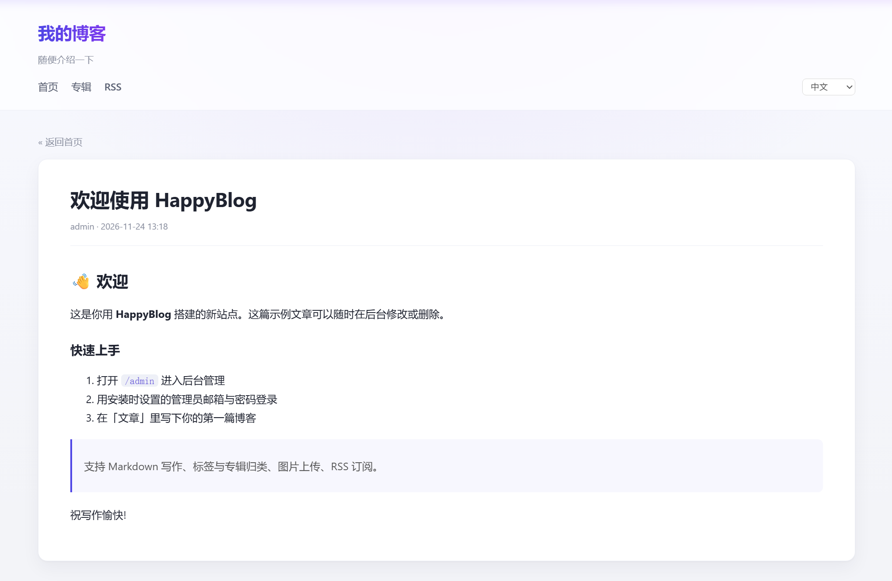
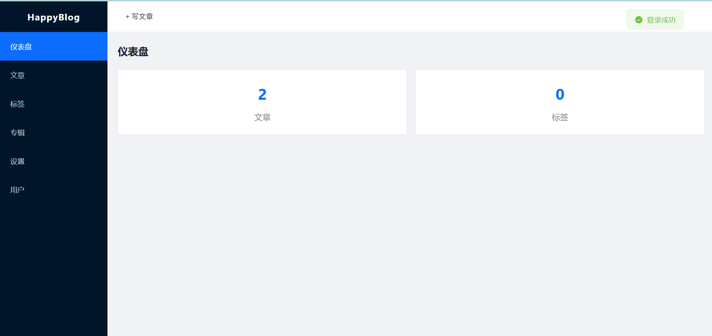
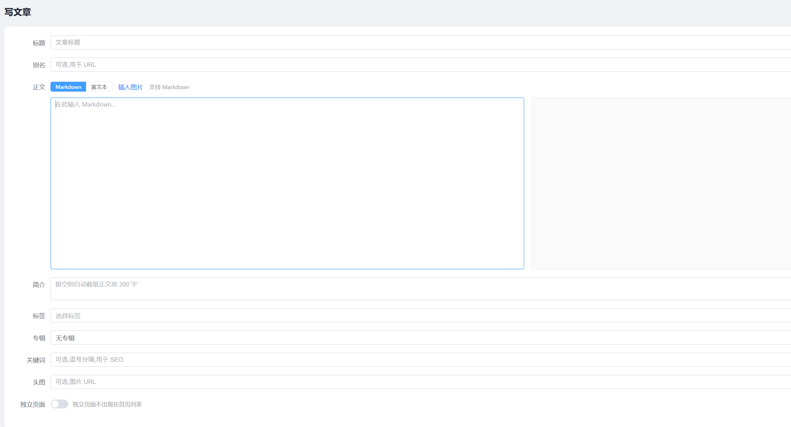

<div align="center">

# HappyBlog

**A self-hosted blog in a single Go binary — download it, run it, finish setup in your browser.**

No external database, no CGO, no config files to hand-edit. SQLite by default (MySQL/MariaDB optional), with the reader site and admin panel (Vue 3 + Element Plus) embedded right into the binary.

English · [中文](README.zh-CN.md)

[](https://github.com/swordphp/happyblog/releases)
[](https://github.com/swordphp/happyblog/actions/workflows/ci.yml)
[](LICENSE)
[](https://github.com/swordphp/happyblog/stargazers)


</div>

## Why HappyBlog

- **One file to deploy.** `CGO_ENABLED=0` pure-Go build cross-compiles to a single binary for Linux / macOS / Windows (amd64 & arm64). The whole frontend is embedded via `go:embed`.
- **Zero database setup.** Ships with pure-Go SQLite — nothing to install. Point it at MySQL/MariaDB later if you outgrow it.
- **Browser-based install wizard.** No YAML to hand-write; fill a form, it generates keys, creates the admin and two sample posts, and you're live — no restart.
- **Reader site + admin in one SPA.** Vue 3 everywhere; Element Plus admin; Markdown *and* rich-text editing; tags, albums, image upload (local or Qiniu OSS), RSS, and a read-only public API.
- **Bilingual UI.** Built-in zh/en switch (vue-i18n).

## Screenshots

| Reader | Article | Admin | Editor |
| --- | --- | --- | --- |
|  |  |  |  |

## Quick start

### Option A — Download a binary (simplest)

Grab the archive for your OS from [Releases](https://github.com/swordphp/happyblog/releases/latest), extract, and run:

```bash
./happyblog            # Windows: happyblog.exe
```

Open http://localhost:8888 and complete the install wizard. Done.

### Option B — Docker (one line)

```bash
docker compose up -d
```

Then open http://localhost:8888. All data (SQLite DB, config, uploads, logs) persists in a named volume. For MySQL/MariaDB instead, use `docker compose -f docker-compose.mysql.yml up -d`.

### Option C — Build from source

Requires Go 1.26+ and Node 22+ (Node only to build the frontend, which is committed in `web/dist`):

```bash
make all               # build frontend + compile binary
./happyblog
```

## Deploy

- **Your own VPS (systemd):** copy the binary, drop in [`deploy/happyblog.service`](deploy/happyblog.service), `systemctl enable --now happyblog`. Full steps in [deploy/](deploy/README.md).
- **Render:** one click — the repo ships a [`render.yaml`](render.yaml) blueprint. Persistent data needs a paid (starter+) instance; free is fine for a trial.

  [](https://render.com/deploy?repo=https://github.com/swordphp/happyblog)

- **Railway:** the repo ships [`railway.json`](railway.json); add a volume mounted at `/data`. See [deploy/](deploy/README.md) (publishing the one-click template is a one-time dashboard step).
- **Fly.io:** the repo ships [`fly.toml`](fly.toml). `fly launch --copy-config --no-deploy` → `fly volumes create happyblog_data` → `fly deploy`. See [deploy/](deploy/README.md).

Port is `:8888` by default, or `$PORT` if set (Render/Railway/Fly inject it automatically).

## Features

- Articles with Markdown **or** rich-text (Quill) editing, drafts, standalone pages, slugs, SEO fields
- Tags (many-to-many) and albums (one-to-many) with live article counts
- Image upload: local disk (default) or Qiniu OSS, switchable via `storage.driver`
- Read-only public API + RSS 2.0 feed
- Configurable GitHub link in the reader header
- Bilingual UI (中文 / English), persisted to localStorage
- SQLite (default) / MySQL / MariaDB with automatic table migration

## HappyBlog vs. the usual options

| | HappyBlog | Ghost | Hugo | WordPress |
| --- | --- | --- | --- | --- |
| Deploy | 1 binary | Node + DB | static build | PHP + MySQL |
| Database | **none needed** (SQLite) | MySQL | none | MySQL |
| Admin UI | built in | built in | none | built in |
| Dynamic site | ✅ | ✅ | ❌ (static) | ✅ |
| Runtime deps | **none** | Node | — | PHP |

## Public API

Unified envelope: `{ "errNo": 0, "errMsg": "success", "data": ... }`. Only published/public content is exposed.

| Method | Path | Description |
| --- | --- | --- |
| GET | `/api/article/list/:page` | Published articles, paginated (10/page) |
| GET | `/api/article/info/:id` | One published article (with tags & album) |
| GET | `/api/tags` | All tags |
| GET | `/api/tag/:id/articles` | Published articles under a tag |
| GET | `/api/albums/:page` | Public albums, paginated |
| GET | `/api/album/:id` | One public album and its articles |
| GET | `/api/rss` | RSS 2.0 feed |

## Development

```bash
cd web && npm run dev     # Vite dev server on :5173 (proxies /api, /admin/api to :8888)
go run .                  # backend on :8888
```

See [DESIGN](Design.md) for architecture. Contributions welcome — issues and PRs appreciated.

## License

[MIT](LICENSE)
