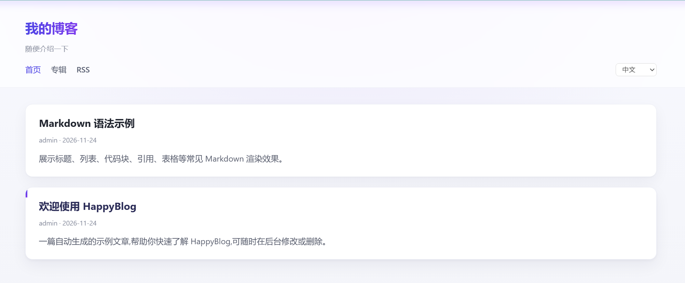
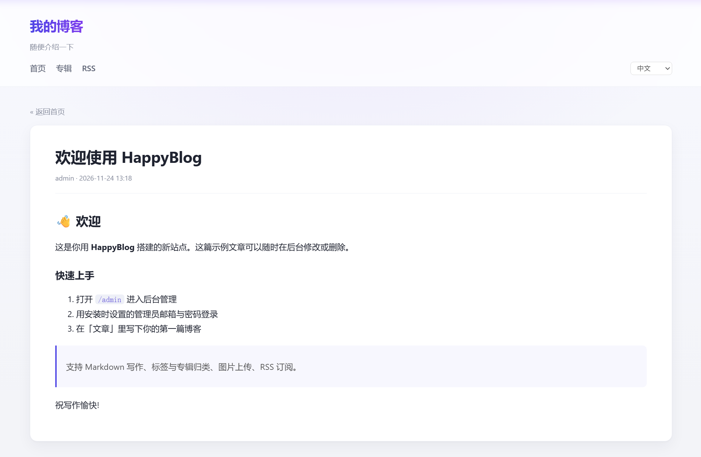
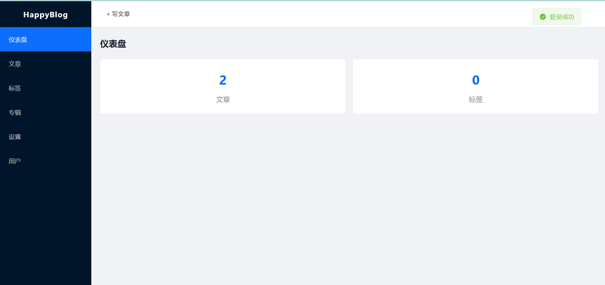
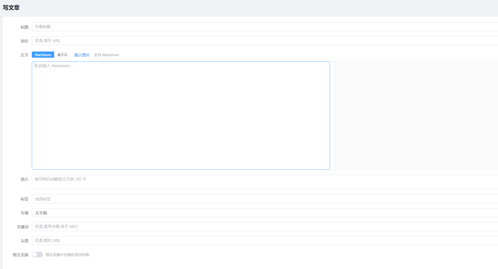

<div align="center">

# HappyBlog

**一个装进单个 Go 二进制的自托管博客 —— 下载、运行、浏览器里完成安装即可。**

无需外置数据库、无需 CGO、无需手写配置。默认用 SQLite(可选 MySQL/MariaDB),读者端与后台管理(Vue 3 + Element Plus)全部 `go:embed` 内嵌进二进制。

[English](README.md) · 中文

[](https://github.com/swordphp/happyblog/releases)
[](https://github.com/swordphp/happyblog/actions/workflows/ci.yml)
[](LICENSE)
[](https://github.com/swordphp/happyblog/stargazers)



</div>

## 为什么选 HappyBlog

- **一个文件就能部署。** `CGO_ENABLED=0` 纯 Go 编译,交叉编译出 Linux / macOS / Windows(amd64 & arm64)单文件,前端经 `go:embed` 一并内嵌。
- **零数据库配置。** 内置纯 Go 的 SQLite,什么都不用装;以后需要再换 MySQL/MariaDB。
- **图形化安装向导。** 不用手写 YAML,填个表单自动生成密钥、建管理员和两篇示例文章,全程无需重启。
- **读者端 + 后台一套 SPA。** 全站 Vue 3,后台 Element Plus;支持 Markdown **和**富文本编辑;标签、专辑、图片上传(本地/七牛)、RSS、对外只读 API。
- **中英双语界面。** 内置 vue-i18n 一键切换。

## 截图

| 读者端 | 文章页 | 后台 | 编辑器 |
| --- | --- | --- | --- |
|  |  |  |  |

## 快速开始

### 方式一 —— 下载二进制(最简单)

从 [Releases](https://github.com/swordphp/happyblog/releases/latest) 下载对应系统的压缩包,解压后运行:

```bash
./happyblog            # Windows: happyblog.exe
```

浏览器打开 http://localhost:8888 完成安装向导即可。

### 方式二 —— Docker(一行启动)

```bash
docker compose up -d
```

打开 http://localhost:8888。所有数据(SQLite 库、配置、上传、日志)持久化在命名卷里。想用 MySQL/MariaDB:`docker compose -f docker-compose.mysql.yml up -d`。

### 方式三 —— 源码构建

需要 Go 1.26+ 和 Node 22+(Node 仅用于构建前端,产物已提交在 `web/dist`):

```bash
make all               # 构建前端 + 编译二进制
./happyblog
```

## 部署

- **自己的 VPS(systemd)**:拷贝二进制,放入 [`deploy/happyblog.service`](deploy/happyblog.service),`systemctl enable --now happyblog`。完整步骤见 [deploy/](deploy/README.md)。
- **Render**:一键部署,仓库自带 [`render.yaml`](render.yaml)。数据持久化需付费档(starter+),free 档适合试跑。

  [](https://render.com/deploy?repo=https://github.com/swordphp/happyblog)

- **Railway**:仓库自带 [`railway.json`](railway.json);记得加一个挂载到 `/data` 的 Volume。一键按钮需先在 Railway 后台发布模板(一次性),见 [deploy/](deploy/README.md)。

端口默认 `:8888`,设置了 `PORT` 则用它(Render/Railway/Fly 会自动注入)。

## 功能

- 文章支持 Markdown **或**富文本(Quill)编辑,草稿、独立页面、别名、SEO 字段
- 标签(多对多)、专辑(一对多)及文章计数实时维护
- 图片上传:本地磁盘(默认)/ 七牛云,由 `storage.driver` 切换
- 对外只读 API + RSS 2.0 订阅
- 读者端页头可配置 GitHub 链接
- 中英双语界面,持久化到 localStorage
- SQLite(默认)/ MySQL / MariaDB,自动建表迁移

## 和常见方案对比

| | HappyBlog | Ghost | Hugo | WordPress |
| --- | --- | --- | --- | --- |
| 部署 | 1 个二进制 | Node + 数据库 | 静态构建 | PHP + MySQL |
| 数据库 | **无需**(SQLite) | MySQL | 无 | MySQL |
| 后台 UI | 自带 | 自带 | 无 | 自带 |
| 动态站点 | ✅ | ✅ | ❌(静态) | ✅ |
| 运行时依赖 | **无** | Node | — | PHP |

## 对外 API

统一返回体:`{ "errNo": 0, "errMsg": "success", "data": ... }`,只暴露已发布 / 公开内容。

| 方法 | 路径 | 说明 |
| --- | --- | --- |
| GET | `/api/article/list/:page` | 已发布文章分页(每页 10 条) |
| GET | `/api/article/info/:id` | 单篇已发布文章(含标签、专辑) |
| GET | `/api/tags` | 全部标签 |
| GET | `/api/tag/:id/articles` | 某标签下的已发布文章 |
| GET | `/api/albums/:page` | 公开专辑分页 |
| GET | `/api/album/:id` | 单个公开专辑及其文章 |
| GET | `/api/rss` | RSS 2.0 订阅 |

## 本地开发

```bash
cd web && npm run dev     # Vite 开发服务器 :5173(已代理 /api、/admin/api 到 :8888)
go run .                  # 后端 :8888
```

架构见 [设计文档](Design.md)。欢迎提 issue 和 PR。

## 许可证

[MIT](LICENSE)
